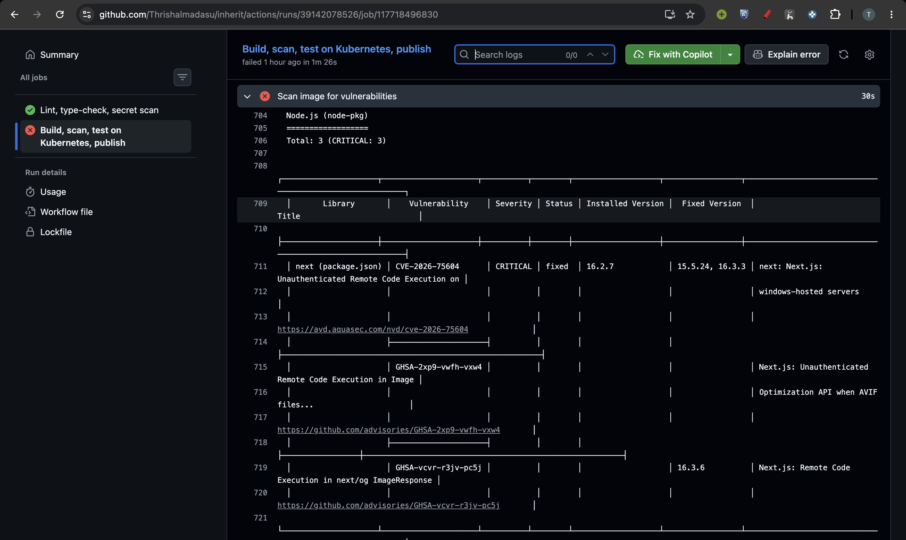
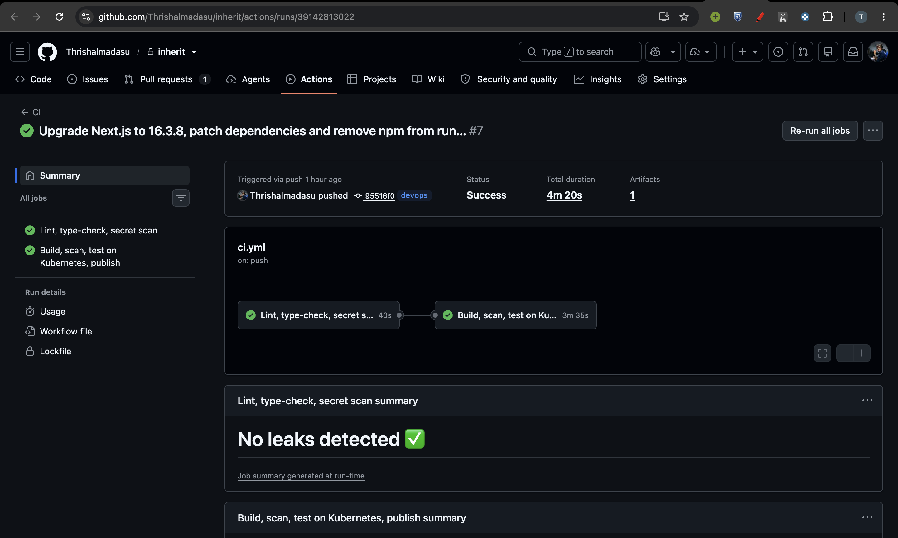
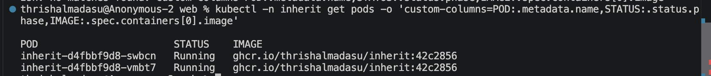
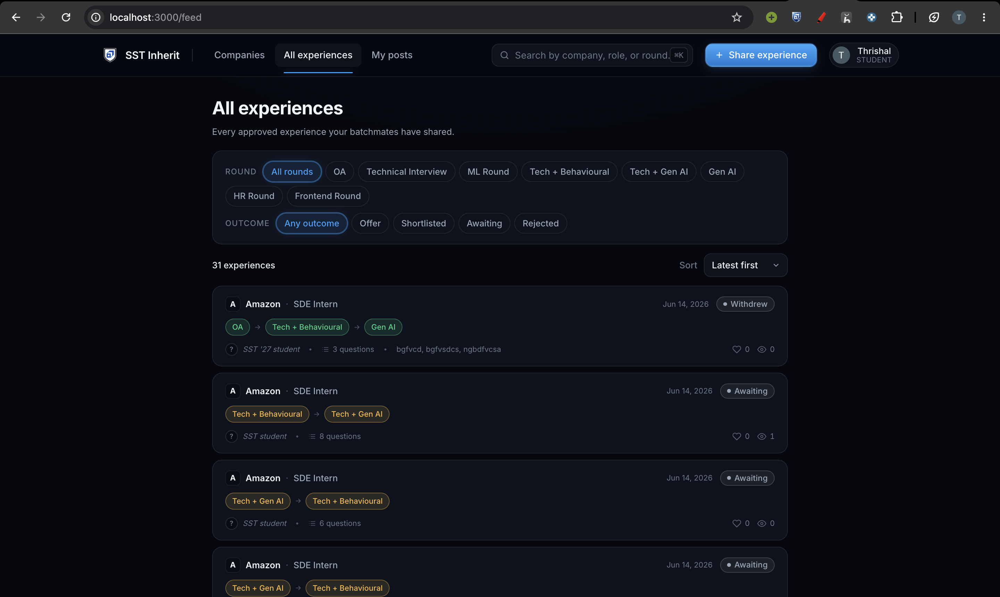
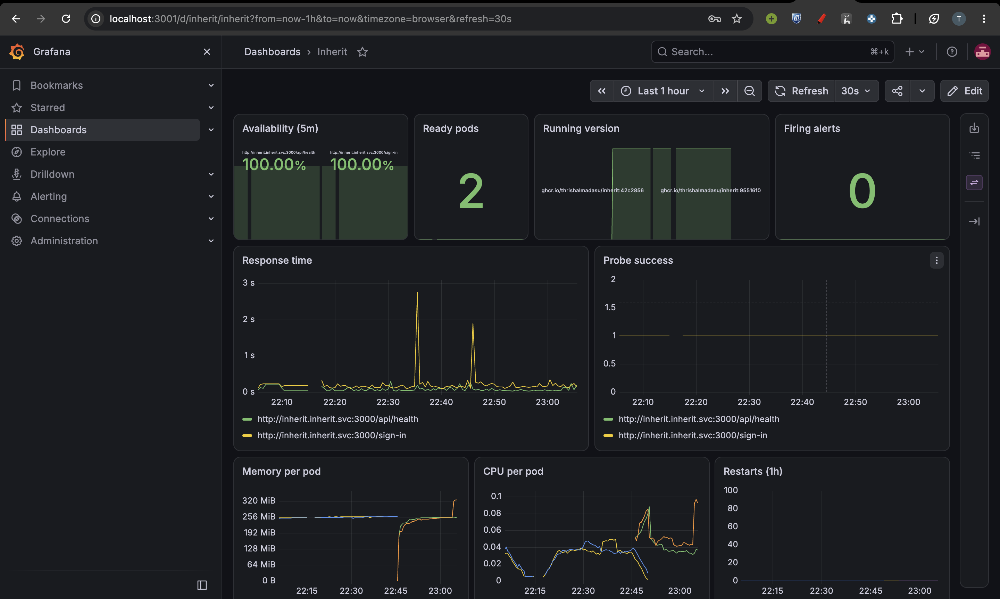
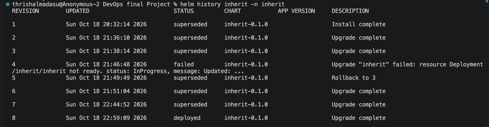

# Deployment and operations

Inherit is an existing web app where students share and browse placement interview experiences (Next.js, Clerk for sign-in, Neon Postgres). Before this work it was only hosted on Vercel, with no containers, Kubernetes, pipeline or monitoring. This document covers how it is now built, deployed and monitored.

## Links

- Repository: https://github.com/Thrishalmadasu/inherit
- Before these changes: https://github.com/Thrishalmadasu/inherit/commit/9da0db91059205506507751dc9e4cea1ef0b5a7a
- Pull request: https://github.com/Thrishalmadasu/inherit/pull/1

## What I added

- Dockerfile to build the app as a container. It runs as a non-root user and has a /api/health endpoint that returns the running version.
- Helm chart to run the app on Kubernetes (kind). It runs 2 copies of the app, updates them one at a time, checks their health, limits memory, and blocks network traffic that is not needed.
- GitHub Actions pipeline. On every push it runs lint, type-check and a secret scan, builds the image tagged with the commit, scans it for vulnerabilities, test-deploys it on a temporary cluster and then publishes it to GitHub Container Registry.
- A deploy script (scripts/deploy.sh) that deploys a chosen commit and rolls back automatically if the new version is not healthy.
- Monitoring with Prometheus and Grafana. The app is checked every 15 seconds, there is a dashboard, and 4 alerts (target: 99% of checks succeed).
- Security fixes. The pipeline found critical vulnerabilities in Next.js 16.2.7, so I upgraded to 16.3.8 and removed npm from the final image. Secrets are never stored in Git or in the image.

## How to run it

### Tools needed

Colima (Docker runtime), Docker, kind (local Kubernetes), Helm, kubectl.

```bash
brew install colima docker kind helm kubectl
colima start --cpu 4 --memory 5 --disk 30
kind create cluster --name inherit
```

### Install monitoring

```bash
helm repo add prometheus-community https://prometheus-community.github.io/helm-charts
helm repo update
kubectl create namespace monitoring
kubectl -n monitoring create secret generic grafana-admin \
  --from-literal=admin-user=admin --from-literal=admin-password="$(openssl rand -base64 18)"
helm install kps prometheus-community/kube-prometheus-stack --version 92.10.1 \
  -n monitoring -f monitoring/kube-prometheus-stack.yaml --wait --timeout 8m
helm install blackbox prometheus-community/prometheus-blackbox-exporter --version 11.20.0 \
  -n monitoring -f monitoring/blackbox-exporter.yaml --wait
```

### Deploy the app

The secrets come from a local .env.local file that is not in the repository.

```bash
kubectl create namespace inherit
kubectl -n inherit create secret generic inherit-secrets \
  --from-env-file=<(grep -E '^(DATABASE_URL|CLERK_SECRET_KEY|NEXT_PUBLIC_CLERK_PUBLISHABLE_KEY|OPS_EMAILS)=' .env.local | sed -E 's/^([A-Z_]+)="(.*)"$/\1=\2/')
scripts/deploy.sh <commit-sha>
```

### Open it

```bash
kubectl -n inherit port-forward svc/inherit 3000:3000
kubectl -n monitoring port-forward svc/kps-grafana 3001:80
kubectl -n monitoring port-forward svc/kps-kube-prometheus-stack-prometheus 9090:9090
```

- App: http://localhost:3000
- Grafana: http://localhost:3001/d/inherit/inherit (user admin, password from the command below)
- Prometheus alerts: http://localhost:9090/alerts

```bash
kubectl -n monitoring get secret grafana-admin -o jsonpath='{.data.admin-password}' | base64 -d; echo
```

## Known limitations

- Runs on a single-node local cluster, so if that node goes down everything goes down.
- No Ingress or HTTPS. The app is opened with kubectl port-forward.
- No tracing, and logs are only read with kubectl logs.
- Kubernetes Secrets are only base64-encoded, not encrypted.
- The app is allowed to make HTTPS calls to any address, not only Neon and Clerk.
- Deploying to the cluster is a manual step (scripts/deploy.sh).

## Evidence












